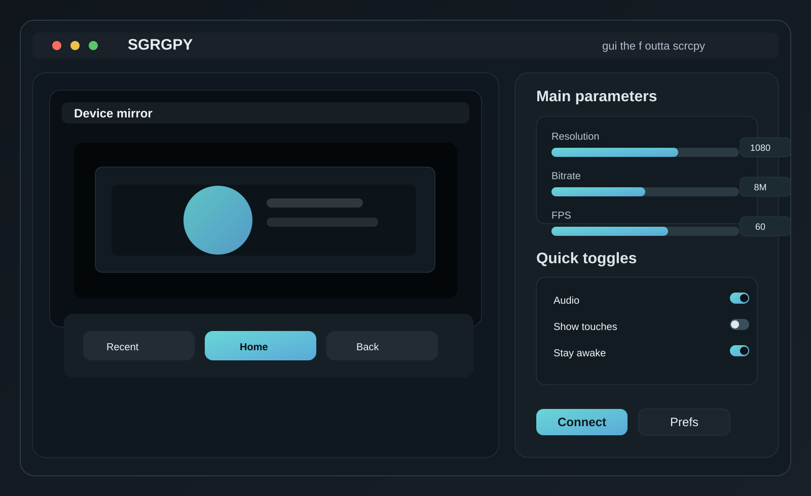
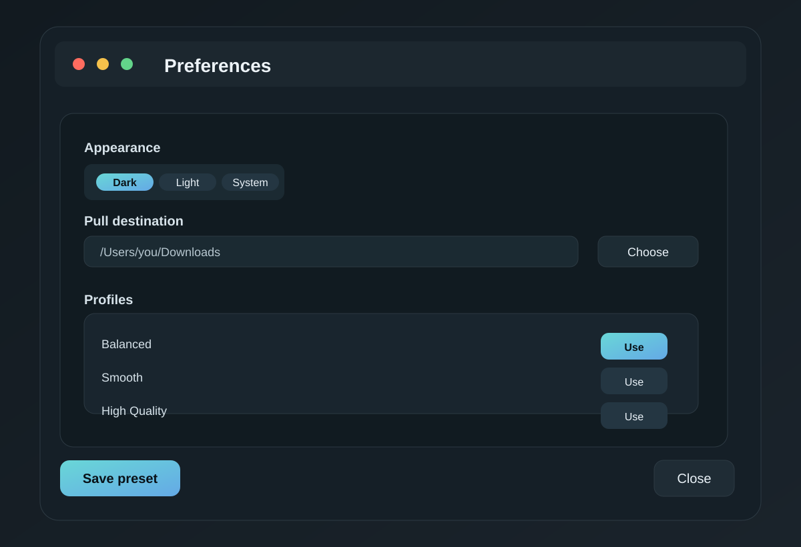

# SGRGPY

SGRGPY is a macOS-first desktop GUI for scrcpy, designed to bring the power of Android screen mirroring into a clean, native app that feels at home on Monterey and newer Macs.

This project wraps the real `scrcpy` CLI with a polished desktop interface, so you get a native app experience without sacrificing compatibility with the upstream tool.

## Tagline

`gui the f outta scrcpy`

## Features

- macOS 12+ native desktop UI
- mirror mode and extended-display mode
- resolution, bitrate, and FPS controls with slider + numeric input
- Android-style Recent / Home / Back controls
- appearance settings and preferences via `Command + ,`
- profile presets for common sessions
- configurable pull destination and recording output path
- minimal neutral palette with a bright accent for emphasis
- bundle generation for a clickable macOS `.app`

## Screenshots





## Requirements

- macOS 12 Monterey or newer
- Xcode Command Line Tools
- `scrcpy` installed and available on `PATH`, or set `SCRCPY_BIN`

Install `scrcpy`:

```bash
brew install --cask android-platform-tools
brew install scrcpy
```

If needed, export the binary manually:

```bash
export SCRCPY_BIN=/opt/homebrew/bin/scrcpy
```

## Build

```bash
./build_app.sh
```

This produces:

```text
dist/SGRGPY.app
```

## Project structure

```text
.
├── Package.swift
├── README.md
├── build_app.sh
├── .gitignore
├── Sources/
│   └── SGRGPY/
│       └── main.swift
├── assets/
│   ├── icon.svg
│   ├── screenshot-main.svg
│   └── screenshot-preferences.svg
└── dist/
    └── SGRGPY.app
```

## License

This project is intended as a desktop front-end for `scrcpy` and follows the same open-source spirit as the upstream project.
